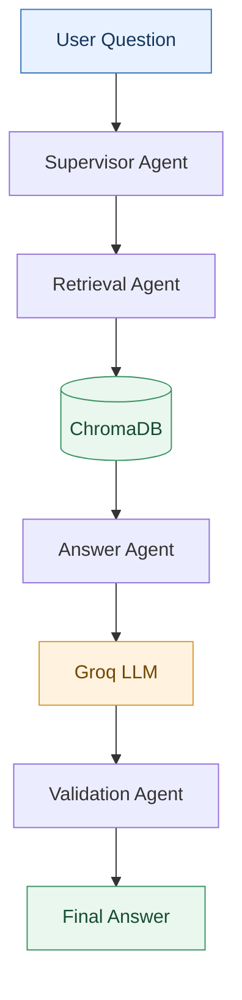

# Multi-Agent Customer Service Assistant

An AI-powered assistant for customer service agents, built with Retrieval-Augmented Generation (RAG) and LangGraph.

The application retrieves relevant information from a dedicated knowledge base and generates contextual answers to support customer service operations.

---

## Overview

Customer service agents regularly deal with complaints, difficult interactions, communication challenges, and customer satisfaction issues.

This project aims to simplify access to practical guidance by allowing agents to ask questions in natural language and receive answers grounded in a collection of customer service documents.

---

## Knowledge Base

The system currently covers seven main topics:

| # | Document Topic |
|---|----------------|
| **01** | Customer Service Fundamentals |
| **02** | Call Handling Procedures |
| **03** | Complaint and Conflict Management |
| **04** | Stress and Emotional Management |
| **05** | Professional Communication Skills |
| **06** | Quality Assurance and Performance |
| **07** | Workplace Ethics and Discipline |

---

## Architecture

The application follows a multi-agent architecture orchestrated with **LangGraph**. Each agent has a specialized responsibility within the RAG pipeline.

### Agent Components

| Agent | Responsibility |
|-------|----------------|
| **Supervisor Agent** | Checks incoming questions and controls workflow routing. |
| **Retrieval Agent** | Searches the knowledge base for relevant information using ChromaDB. |
| **Answer Agent** | Generates contextual answers using the Groq API. |
| **Validation Agent** | Performs basic checks on the generated answer and retrieved context. |

### RAG Workflow



---

## Technology Stack

| Technology | Role |
|------------|------|
| **Python 3.11** | Main programming language |
| **LangGraph** | Multi-agent workflow orchestration |
| **LangChain** | Document processing and RAG components |
| **Sentence Transformers** | Text embedding generation |
| **Multilingual E5 Small** | Embedding model |
| **ChromaDB** | Vector database and semantic search |
| **Groq API** | Remote LLM inference |
| **Streamlit** | Web application interface |

### Architecture Approach

The project uses a hybrid architecture:
- **Local processing:** Document loading, text chunking, embedding generation, vector storage, and retrieval.
- **Remote inference:** Answer generation through the Groq API.

*This approach reduces local hardware requirements by avoiding the need to run a large language model on the development machine.*

---

## Project Structure

```text
Multi-Agent-Customer-Service-Assistant/
│
├── data/
│   ├── raw/                  # Source documents
│   └── processed/            # Processed documents
│
├── vectorstore/              # Persistent ChromaDB storage
│
├── src/
│   ├── ingestion/            # Document loading and chunking
│   ├── retrieval/            # Embeddings and vector search
│   ├── agents/               # Specialized agents
│   ├── graph/                # LangGraph workflow and state
│   └── config.py             # Project configuration
│
├── test/                     # Component and workflow tests
│
├── app.py                    # Streamlit application
├── requirements.txt          # Python dependencies
├── .env.example              # Environment variable template
├── .gitignore
└── README.md
```

---

## Getting Started

### Prerequisites
- Python 3.11
- Git
- A Groq API key
- Internet connection (for model downloads and API inference)

### Installation Steps

1. **Clone the repository:**
   ```bash
   git clone https://github.com/YOUR_USERNAME/Multi-Agent-Customer-Service-Assistant.git
   cd Multi-Agent-Customer-Service-Assistant
   ```

2. **Create a virtual environment:**
   ```bash
   python -m venv .venv
   ```
   Activate it (on Windows PowerShell):
   ```powershell
   .\.venv\Scripts\Activate.ps1
   ```
   *(On macOS/Linux: `source .venv/bin/activate`)*

3. **Install dependencies:**
   ```bash
   pip install -r requirements.txt
   ```

4. **Configure environment variables:**
   Create a `.env` file in the project root and add your Groq API key:
   ```env
   GROQ_API_KEY=your_groq_api_key
   ```
   > **Security Note:** Never commit your `.env` file or expose your API key. Use `.env.example` as a template.

5. **Build the vector database:**
   Place the source Word documents in `data/raw/`, then run:
   ```bash
   python -m test.test_vector_store
   ```
   *This step builds the vector database from the source documents using the project's ingestion and embedding pipeline. The first execution may download the embedding model.*

6. **Launch the application:**
   ```bash
   streamlit run app.py
   ```
   Open the application in your browser: `http://localhost:8501`

---

## Testing

The `test/` directory contains tests for individual components and the complete workflow.
Testing covers the following areas:
- **Document Ingestion:** Verifies document loading, text extraction, and chunking.
- **Embeddings & Vector Store:** Checks embedding generation, document indexing, and vector storage.
- **Retrieval:** Evaluates the system's ability to retrieve relevant information from the knowledge base.
- **Agents:** Tests each agent's individual responsibilities, including question routing, answer generation, and validation.
- **Workflow:** Verifies the execution and coordination of all agents through LangGraph.

Run individual tests from the project root:
```bash
python -m test.test_ingestion
python -m test.test_retrieval_agent
python -m test.test_workflow_mock
...
---

## Limitations & Future Improvements

| Current Limitation | Potential Improvement |
|--------------------|-----------------------|
| Retrieval accuracy needs further evaluation | Introduce retrieval metrics such as Recall@K and Precision@K |
| No conversation history | Add multi-turn conversation support |
| Limited document formats | Support PDF and additional formats |
| Basic validation mechanism | Implement factual grounding and answer evaluation |
| Basic agent routing | Introduce more advanced routing and decision-making |

---

## Important Note

> **Note:** The Validation Agent currently performs basic structural and consistency checks. A successful validation status does not guarantee that the generated answer is factually accurate or fully grounded in the retrieved documents.

---

*Developed as an AI engineering project exploring RAG pipelines, multi-agent orchestration, and LLM-powered applications.*
